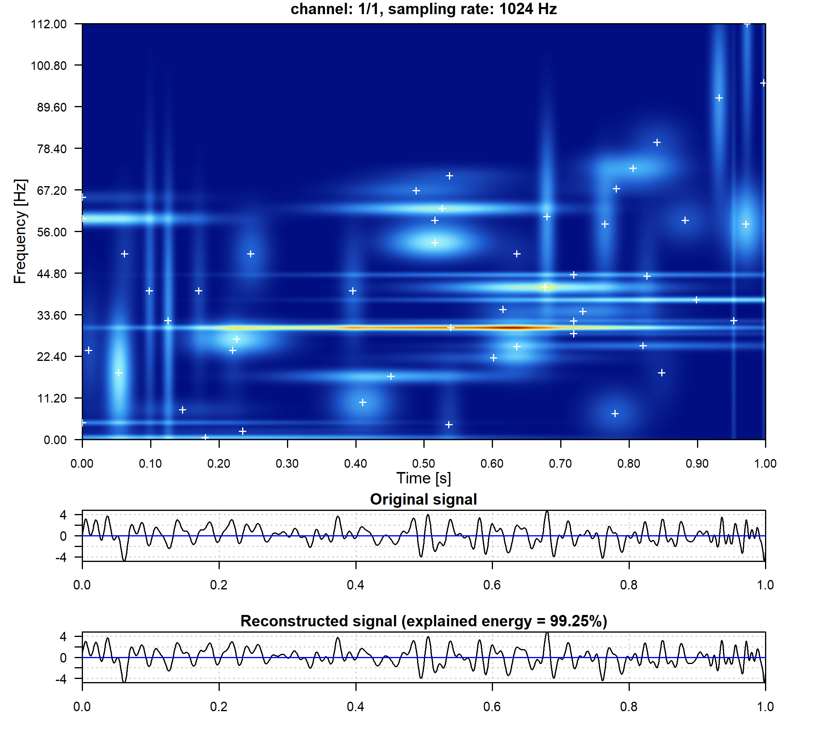
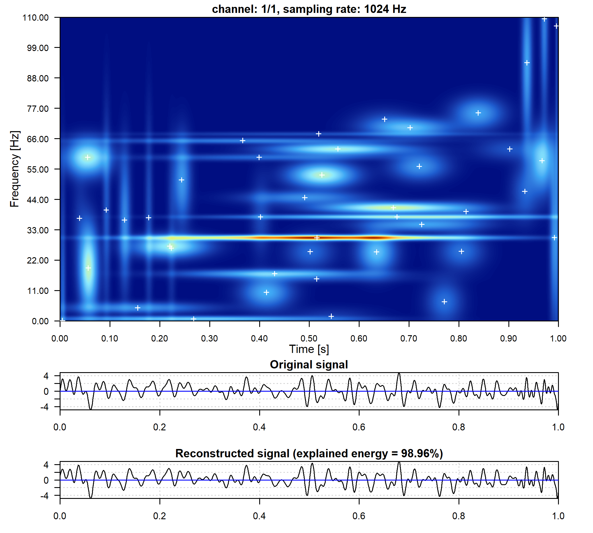
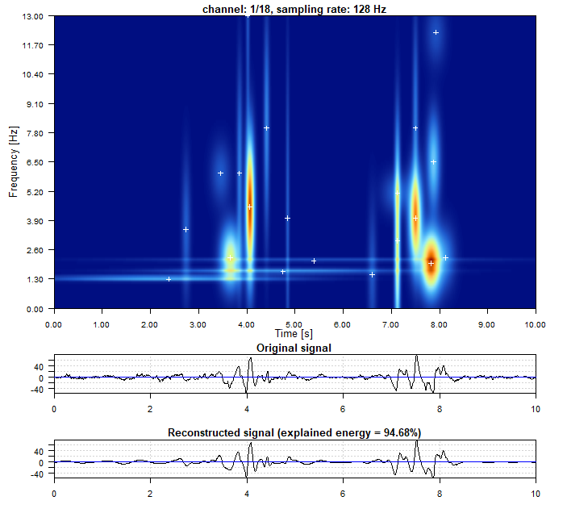
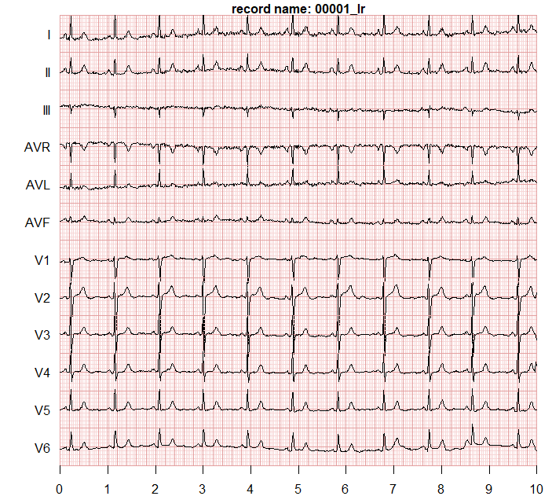
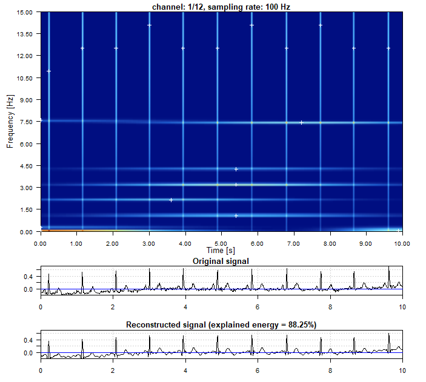
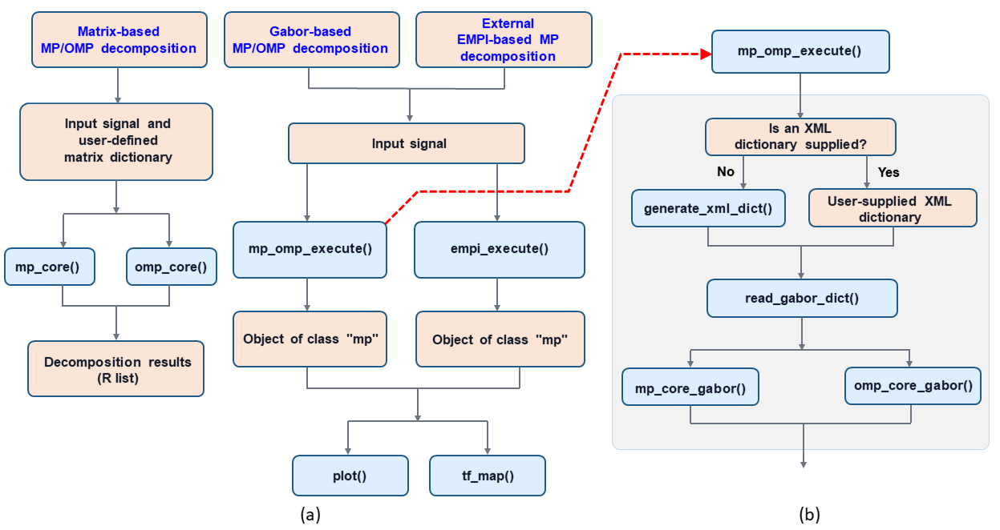

<style>
body {
  max-width: 1200px;
  margin-left: auto;
  margin-right: auto;
  padding-left: 30px;
  padding-right: 30px;
  box-sizing: border-box;
}

img {
  max-width: 100%;
  height: auto;
}
</style>

# MatchingPursuit: An R Framework for Sparse Time-Series Decomposition Using Matching Pursuit and Orthogonal Matching Pursuit

<!-- badges: start -->
[](https://CRAN.R-project.org/package=MatchingPursuit)
[](https://CRAN.R-project.org/package=MatchingPursuit)
[](https://cran.r-project.org/package=MatchingPursuit)
<!-- badges: end -->

## Purpose

MatchingPursuit is an R package for sparse decomposition of single- and multichannel 
biomedical and general time-series signals using **Matching Pursuit** (MP) and 
**Orthogonal Matching Pursuit** (OMP). Multichannel signals are decomposed independently, 
without joint atom selection across channels.

The package provides four native R implementations:
- **MP-Matrix** using `mp_core()` — Matching Pursuit with user-defined **matrix-based** dictionaries.
- **OMP-Matrix** using `omp_core()` — Orthogonal Matching Pursuit with user-defined **matrix-based** dictionaries.
- **MP-Gabor** using `mp_core_gabor()` — Matching Pursuit with parameterized **Gabor-based** dictionaries.
- **OMP-Gabor** using `omp_core_gabor()` — Orthogonal Matching Pursuit with parameterized **Gabor-based** dictionaries.

The Gabor-based implementations use FFT-based projections and analytical phase optimization 
without materializing the full dictionary matrix. The package also provides an interface to the 
external **Enhanced Matching Pursuit Implementation (EMPI)**.

Additional features include:

- An educational and reference OMP implementation using `omp_reference()`.
- Support for CSV, EDF/EDF+, and WFDB signal formats.
- Signal preprocessing, including filtering (using notch, low-pass, high-pass, 
  band-pass, and band-stop filters) and resampling.
- EEG montage construction (bipolar, referential, and average-reference).
- Signal reconstruction and time–frequency visualization.


## Installation

You can install the latest version available on 
[CRAN](https://CRAN.R-project.org/package=MatchingPursuit) with:

```r
install.packages("MatchingPursuit")
```

The development version can be installed from GitHub using:

```r
remotes::install_github("artur-gramacki/MatchingPursuit")
```

## Quick start

### MP-Gabor and OMP-Gabor

For Gabor-based decomposition, `mp_omp_execute()` provides a high-level interface 
to the native R implementations MP-Gabor and OMP-Gabor. It generates or reads a 
parameterized Gabor dictionary and performs decomposition using `mp_core_gabor()`
or `omp_core_gabor()`, respectively. Each channel is decomposed independently, and 
the results are combined into an object of class `mp` without materializing the 
full dictionary matrix.

If `dictionary = NULL` (default option), an XML Gabor dictionary specification 
is generated internally.


```r
sig_file <- system.file("extdata", "sample1.csv", package = "MatchingPursuit")
signal <- read_csv_signals(sig_file)

# use mode = "omp" for OMP-Gabor
out_mp <- mp_omp_execute(
  signal = signal,
  mode = "mp",         
  n_nonzero_coefs = 50,
  verbose = TRUE
)

plot(out_mp)
```

The time–frequency map below shows the energy distribution of the selected atoms. 
White crosses indicate the centers of individual time–frequency blobs, 
corresponding to the atoms' central time and frequency coordinates. 
The lower panels show the original and reconstructed signals. In this example, 
the reconstruction explains 99.25% of the signal energy.

<p align="center">
  
</p>

Alternatively, a user-defined XML dictionary can be supplied through the dictionary 
argument. The XML file defines the Gabor dictionary parameters, including window 
lengths, time shifts, and FFT sizes. The dictionary is loaded and processed without 
constructing the full matrix of sampled atoms.

```r
sig_file <- system.file("extdata", "sample1.csv", package = "MatchingPursuit")
signal <- read_csv_signals(sig_file)

xml_file <- system.file("extdata", "sample1.xml", package = "MatchingPursuit")

# use mode = "omp" for OMP-Gabor
out_mp <- mp_omp_execute(
  signal = signal,
  mode = "mp",
  dictionary = xml_file,
  n_nonzero_coefs = 50
)

plot(out_mp)
```

The XML file defines the Gabor dictionary using one or more blocks. Each block 
specifies the window length (`windowLen`), time shift (`windowShift`), and FFT size 
(`fftSize`). For example, the first two blocks of the included `sample1.xml` file are:

```r
<dict>
  <block>
    <param name="type" value="gabor"/>
    <param name="windowLen" value="17"/>
    <param name="windowShift" value="1"/>
    <param name="fftSize" value="32"/>
  </block>
  <block>
    <param name="type" value="gabor"/>
    <param name="windowLen" value="25"/>
    <param name="windowShift" value="1"/>
    <param name="fftSize" value="64"/>
  </block>
</dict>
```

The complete `sample1.xml` file contains 13 blocks with different parameter combinations. 
The dictionary is loaded and processed without materializing the full matrix of sampled 
atoms. For a detailed description of the XML dictionary structure, its parameters, 
and dictionary generation, see the package vignette.

### MP-Matrix and OMP-Matrix

The native R implementations MP-Matrix and OMP-Matrix support arbitrary user-defined 
matrix-based dictionaries through `mp_core()` and `omp_core()`, respectively. 
Dictionary atoms are supplied as columns of a numeric matrix and normalized 
internally to unit L2 norm. The following example demonstrates OMP-Matrix.

```r
N <- 256
t <- seq(0, 1, length.out = N)

dictionary <- cbind(
  sin(2 * pi * 5 * t),
  cos(2 * pi * 5 * t),
  sin(2 * pi * 10 * t),
  cos(2 * pi * 10 * t)
)

signal_custom <- sin(2 * pi * 5 * t) + 0.5 * cos(2 * pi * 10 * t)

# use mp_core() for MP-Matrix
out <- omp_core(
  dictionary = dictionary,
  signal = signal_custom,
  n_nonzero_coefs = 2
)

out$support
# [1] 1 4

out$relative_residual_energy
# [1] 1.000000e+00 2.012529e-01 6.721842e-32
```

In this example, OMP-Matrix selects atoms 1 and 4, corresponding to the 5 Hz 
sine and 10 Hz cosine components of the signal. After two iterations, the residual 
energy is effectively zero.

### EMPI

EMPI is an optional external, high-performance implementation of Matching Pursuit. 
It is distributed separately under its own license and is not part of the 
MatchingPursuit package.

EMPI must first be installed using the `empi_install()` function, which downloads 
the required binaries and places them in the appropriate location. The decomposition 
can then be performed using `empi_execute()` and visualized using `plot()`.

```r
sig_file <- system.file("extdata", "sample1.csv", package = "MatchingPursuit")
signal <- read_csv_signals(sig_file)

out_empi <- empi_execute(
  signal = signal
)

plot(out_empi)
```
The time–frequency map shows localized components distributed across time and 
frequency, while the reconstructed signal closely follows the original waveform.
In this example, the selected atoms explain 98.96% of the signal energy.

<p align="center">
  
</p>

 
## Multichannel EEG analysis
 
The following example demonstrates a complete EEG analysis workflow using a 
recording distributed with the package. The analysis consists of five steps: (1) 
importing an EDF recording, (2) filtering, (3) resampling from 256 Hz to 128 Hz, (4) 
constructing an 18-channel bipolar montage, and (5) performing OMP-Gabor decomposition 
followed by time–frequency visualization.
 
### 1. Import the EEG recording

The annotation channel is automatically excluded during EDF import, leaving 19 EEG 
channels for further processing.

```r 
file <- system.file("extdata", "EEG.edf", package = "MatchingPursuit")
signal_eeg <- read_edf_signals(file)

eeg <- signal_eeg$signal
sf <- signal_eeg$sampling_frequency
```

### 2. Apply zero-phase filtering

A notch filter (49–51 Hz), a 40 Hz low-pass filter, and a 1 Hz high-pass filter are 
applied to each EEG channel.

```r
fc <- design_filters(
  sampling_frequency = sf,
  notch = c(49, 51),
  lowpass = 40,
  highpass = 1
)

eeg_f <- eeg

for (m in seq_len(ncol(eeg_f))) {
  eeg_f[, m] <- signal::filtfilt(fc$notch, eeg[, m])
  eeg_f[, m] <- signal::filtfilt(fc$lowpass, eeg_f[, m])
  eeg_f[, m] <- signal::filtfilt(fc$highpass, eeg_f[, m])
}
```

### 3. Resample the filtered signals

The sampling frequency is reduced from 256 Hz to 128 Hz to decrease computational cost. 
This step is optional.

```r
sf_r <- 128
eeg_f_r <- resample_signal(
  signal = eeg_f,
  p = 1,
  q = 2
)
```

### 4. Construct a bipolar EEG montage

The bipolar montage is constructed from 18 electrode pairs.

```r
pairs <- list(
  c("Fp2","F4"), c("F4","C4"), c("C4","P4"), c("P4","O2"),
  c("Fp1","F3"), c("F3","C3"), c("C3","P3"), c("P3","O1"),
  c("Fp2","F8"), c("F8","T4"), c("T4","T6"), c("T6","O2"),
  c("Fp1","F7"), c("F7","T3"), c("T3","T5"), c("T5","O1"),
  c("Fz","Cz"), c("Cz","Pz")
)

eeg_f_r_m <- eeg_montage(
  eeg_f_r,
  montage_type = "bipolar",
  bipolar_pairs = pairs
)

signal <- as_sig(eeg_f_r_m, sf_r)
```

### 5. Perform OMP-Gabor decomposition and visualize the results

Each EEG channel is decomposed independently using 20 selected atoms.

```r
out_omp <- mp_omp_execute(
  signal = signal,
  mode = "omp",
  n_nonzero_coefs = 20,
  verbose = TRUE
)

summary(out_omp)
plot(out_omp)
```

The resulting time–frequency representations show the selected Gabor atoms for 
each EEG channel. More detailed explanations of EEG preprocessing and montage 
construction are provided in the package vignette.

<p align="center">
  
</p>


## Multichannel ECG analysis

MatchingPursuit provides a dedicated plotting method for WFDB (WaveForm DataBase) 
objects, designed primarily for ECG visualization. The method displays individual 
ECG leads on a conventional electrocardiographic grid, with small squares representing 
0.04 s × 0.1 mV and large squares representing 0.20 s × 0.5 mV. Each lead is displayed 
separately with its corresponding label. The plotting function also allows users to 
select a time interval, adjust the vertical spacing between leads, and optionally 
display baseline reference lines.

```r
# ECG data comes from https://physionet.org/content/ptb-xl/1.0.3/
file <- system.file("extdata", "00001_lr.hea", package = "MatchingPursuit")
signal_ecg <- read_wfdb_signals(file)
plot(
  signal_ecg, 
  begin = 0, 
  end = 10, 
  panel_height = 1.0
)
```

<p align="center">
  
</p>

The ECG recording is then decomposed using OMP-Gabor with 20 selected atoms per channel. 
The resulting plot shows the time–frequency representation of the selected Gabor atoms, 
 together with the original and reconstructed ECG signals.

```r
out_omp <- mp_omp_execute(
  signal = signal_ecg,
  mode = "omp",
  n_nonzero_coefs = 20,
  verbose = TRUE
)

plot(out_omp)
```

<p align="center">
  
</p>


## Package architecture

The package provides three main decomposition workflows.

| Workflow | Main functions | Purpose | Recommended use |
|:--|:--|:--|:--|
| **MP-Matrix / OMP-Matrix** | `mp_core()`, `omp_core()` | Sparse decomposition with arbitrary matrix-based dictionaries | General sparse decomposition and experimentation |
| **MP-Gabor / OMP-Gabor** | `mp_core_gabor()`, `omp_core_gabor()`, `mp_omp_execute()` | Sparse decomposition with parameterized Gabor-based dictionaries without explicit materialization | Time–frequency signal decomposition |
| **EMPI** | `empi_execute()` | Gabor-based MP using an external optimized implementation | High-performance time-frequency decomposition |

## Typical workflows

The diagram below illustrates the three main decomposition workflows supported by 
MatchingPursuit: **matrix-based MP/OMP**, **Gabor-based MP/OMP**, and external **EMPI-based MP**.

<p align="center">
  
</p>
**Figure legend:** Blue boxes represent R functions, while light orange boxes represent 
workflow steps, inputs, or output objects.

The **MP-Matrix** / **OMP-Matrix** workflow operates directly on user-defined numeric dictionaries 
through `mp_core()` or `omp_core()`. It supports arbitrary matrix-based dictionaries and returns 
low-level decomposition results, giving users direct control over dictionary construction 
and decomposition parameters.

The **MP-Gabor** / **OMP-Gabor** workflow uses `mp_core_gabor()` and `omp_core_gabor()` for 
decomposition with parameterized Gabor dictionaries. The high-level `mp_omp_execute()` 
function handles XML dictionary generation or selection, calls `read_gabor_dict()`, 
and processes each signal channel independently. Candidate projections are computed 
using FFT-based operations, and atom phases are optimized analytically. Only selected 
atoms are reconstructed in the time domain, without materializing the full dictionary 
matrix. MP updates the residual after each selection, whereas OMP additionally
recomputes the coefficients of all selected atoms using least squares. The results are 
combined into an object of class `mp`.

The **EMPI** workflow provides an external high-performance implementation of MP 
through `empi_execute()`. Decomposition is performed by the external C++ backend, 
and the results are converted into the same `mp` representation used by the native 
Gabor implementations. This allows reconstruction and visualization using common 
functions, including `plot()` and `tf_map()`.

The three workflows differ in dictionary representation and decomposition backend. 
The Gabor-based and EMPI workflows return compatible `mp` objects, enabling 
consistent reconstruction and visualization.

## Documentation

The package documentation, including the vignette and reference
manual, is available on [CRAN](https://CRAN.R-project.org/package=MatchingPursuit)


## Supported input formats

The package supports single- and multichannel time-series signals in the following formats:

- CSV (generic signals)
- EDF/EDF+ (EEG and other physiological recordings)
- WFDB (physiological records)

## Citation

To cite MatchingPursuit in publications, use:
```r
citation("MatchingPursuit")
```

## License

MatchingPursuit is distributed under the GNU General Public License version 3 (GPL-3).

EMPI is external third-party software distributed separately under its own license and 
is not part of the MatchingPursuit package.
